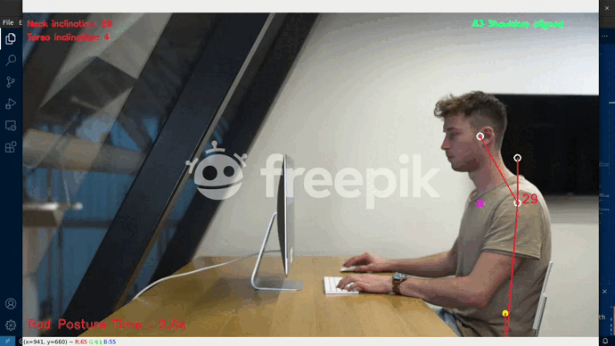

# AlignAI

AlignAI is a real-time posture monitoring application built by **Aditya** with
Python, OpenCV, and MediaPipe. It uses a webcam or video file to detect posture
and provides on-screen feedback while tracking good and bad posture time.



## Features

- Real-time monitoring from a webcam or video file
- Automatic detection of front and side views
- Manual `front` and `side` monitoring modes
- Front-view checks for head centering, shoulder level, hip level, and body lean
- Side-view checks for neck and torso inclination
- Configurable posture and alert thresholds
- Visual posture status, measurements, and landmark tracking
- Warning output when bad posture exceeds the configured time threshold

## Requirements

- Python 3.11
- A webcam for live monitoring, or a supported video file
- Dependencies listed in [`requirements.txt`](requirements.txt)

> MediaPipe 0.10.8 is pinned for Python 3.11 compatibility.

## Installation

```bash
git clone https://github.com/RaoAdii/AlignAI.git
cd AlignAI
python -m venv .venv311
```

Activate the virtual environment:

**Windows**

```powershell
.venv311\Scripts\activate
```

**macOS/Linux**

```bash
source .venv311/bin/activate
```

Install dependencies:

```bash
pip install -r requirements.txt
```

## Usage

Start monitoring with the default webcam and automatic view detection:

```bash
python app.py
```

Monitor a video file:

```bash
python app.py --video "path/to/video.mp4"
```

Choose a monitoring view explicitly:

```bash
python app.py --view front
python app.py --view side
```

The available command-line options are:

| Option | Default | Description |
| --- | ---: | --- |
| `--video` | `0` | Video path, or `0` for the default webcam |
| `--view` | `auto` | View mode: `auto`, `front`, or `side` |
| `--offset-threshold` | `100` | Front-view head-offset threshold |
| `--neck-angle-threshold` | `25` | Maximum neck angle for acceptable posture |
| `--torso-angle-threshold` | `10` | Maximum torso angle for acceptable posture |
| `--time-threshold` | `180` | Seconds before a bad-posture warning |

Press `q` in the video window to stop monitoring.

## Project Structure

```text
AlignAI/
├── app.py
├── requirements.txt
├── test.gif
└── test.mp4
```

## Acknowledgments

AlignAI uses [MediaPipe](https://mediapipe.dev/) for pose estimation and
[OpenCV](https://opencv.org/) for video processing and visualization.

## License

This project is released under the MIT License.
